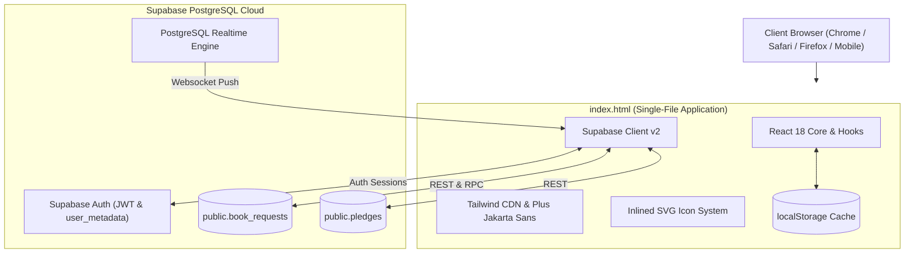
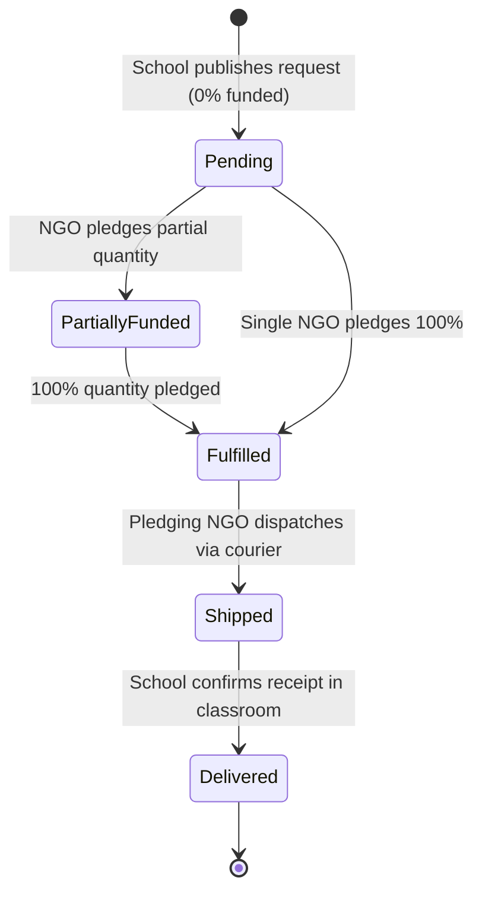

# 🤖 AGENTS.md — Kitaab Dost Network Technical Architecture & Agent Guide

> **Authoritative Technical Reference & Architecture Manifest for AI Coding Agents and Software Engineers.**  
> Platform: **Kitaab Dost Network** (formerly *BookBridge*)  
> Target Region: **Pakistan (Primary, Middle, Matric, Intermediate Education)**  
> Last Updated: **October 2026**

---

## 1. Executive Summary & Project Identity

**Kitaab Dost Network** is a production web platform bridging under-resourced Pakistani government and community schools with verified education NGOs, trusts, and individual book donors.

- **Production Live URL**: [https://richbrokie.github.io/kitaab-dost/](https://richbrokie.github.io/kitaab-dost/)
- **Hosting Environment**: GitHub Pages (Branch: `main`, 100% free hosting, zero server maintenance)
- **Git Repository**: `git@github.com:RichBrokie/kitaab-dost.git`
- **Cloud Backend**: Supabase PostgreSQL (`uqotflogqjlkhozhrpdd.supabase.co`)
- **Local Dev Server**: Python HTTP server on port 3000 (`http://localhost:3000/index.html`)

---

## 2. File Tree & Manifest

All application logic and assets are contained within this lean, zero-build repository:

```
pc-stuff/
├── .gitignore               # Ignores temp files, logs, and OS artifacts
├── AGENTS.md                # (This file) Complete technical documentation for AI agents
├── MANUAL.md                # Comprehensive user guide for schools, headmasters, and NGOs
├── README.md                # Public project overview, features, and setup
├── index.html               # Entire production frontend application (~3350 lines)
└── production-schema.sql    # DDL schema, RLS policies, indexes, and initial seeds for Supabase
```

### File Specifics & Roles

| File | Purpose | Key Details |
| :--- | :--- | :--- |
| **`index.html`** | Single-page application (SPA) containing the entire UI, state, API client, and icons | React 18 UMD + Babel standalone + Tailwind CDN + Supabase Client v2 |
| **`production-schema.sql`** | Supabase PostgreSQL schema | Contains `book_requests` and `pledges` tables, Realtime configuration, and RLS |
| **`README.md`** | GitHub repository landing page | High-level overview, EMIS verification details, and local setup commands |
| **`MANUAL.md`** | Operational handbook | Explains workflows from a Pakistani headmaster and NGO donor perspective |

---

## 3. Technology Stack & Architectural Decisions

### Zero-Build / Zero-Dependency Architecture
The application runs directly in any modern browser without Node.js, Webpack, Vite, or npm build steps:

1. **React 18 (UMD)**:
   - Script: `https://unpkg.com/react@18/umd/react.production.min.js`
   - Script: `https://unpkg.com/react-dom@18/umd/react-dom.production.min.js`
   - Pure React hooks: `useState`, `useMemo`, `useEffect`, `useRef`.
2. **Babel Standalone**:
   - Script: `https://unpkg.com/@babel/standalone/babel.min.js`
   - Compiles `<script type="text/babel">` in the browser.
3. **Tailwind CSS (CDN)**:
   - Script: `https://cdn.tailwindcss.com`
   - Utility-first CSS classes for layout, typography, flexbox/grid, and animations.
4. **Google Fonts**:
   - Family: `Plus Jakarta Sans` (`@import url(...)`) for modern typography.
5. **Database & Realtime Client**:
   - Script: `https://cdn.jsdelivr.net/npm/@supabase/supabase-js@2`
   - Realtime multi-client syncing over PostgreSQL change subscriptions (`public:realtime`).
6. **Inlined SVG Icon System**:
   - Static dictionary `ICON_PATHS` with ~25 inlined Lucide-compatible SVGs to avoid loading heavy third-party icon libraries.
7. **Offline-First Persistence**:
   - `localStorage.getItem('bookbridge_requests')` and `'bookbridge_user'` provide seamless caching when the network is unstable.



---

## 4. Platform Lifecycles & Dual-Portal System

The platform has 4 distinct views managed by the state `activePortal`:

1. **Gateway (`activePortal === 'gateway'`)**:
   - The public landing page.
   - Dual entry doors: **"Enter School Portal"** (amber card) and **"Enter NGO Donor Portal"** (emerald card).
   - Public directory displaying national requests with masked contact numbers for anti-scraping security.
2. **School Portal (`activePortal === 'school'`)**:
   - Designed for teachers, headmasters, and administrators.
   - Allows submitting curriculum book requests (PTB, STB, Oxford, etc.) with verified EMIS numbers.
   - Displays real-time fulfillment bars, NGO courier notes, and the interactive **"Confirm Books Received"** button.
3. **NGO Donor Dashboard (`activePortal === 'ngo'`)**:
   - Designed for education charities, trusts, and individual book donors.
   - Multi-filtering by Subject, Grade Level, Urgency, and Completion status.
   - Pledging modal supporting full or partial book quantities.
   - Generates printable TCS / Leopards courier packing slips.
4. **Impact Dashboard (`activePortal === 'impact'`)**:
   - Public metrics dashboard: total books pledged, estimated students reached ($2\times$ books), and fulfillment distribution across academic subjects.

### Book Request 5-Stage Lifecycle



---

## 5. Security Architecture, RBAC & Ownership Model

A major overhaul was performed to eliminate security and impersonation vulnerabilities:

### 1. Role-Based Access Control (RBAC) Guard
```javascript
useEffect(() => {
  if (currentUser) {
    if (currentUser.role === 'school' && activePortal === 'ngo') {
      setActivePortal('school');
      triggerToast('Access Restricted', 'Your account is registered as a School. NGO Donor Portal is restricted.');
    } else if (currentUser.role === 'ngo' && activePortal === 'school') {
      setActivePortal('ngo');
      triggerToast('Access Restricted', 'Your account is registered as an NGO. School Request Portal is restricted.');
    } else if (activePortal === 'gateway') {
      setActivePortal(currentUser.role);
    }
  }
}, [currentUser, activePortal]);
```

### 2. Intra-School Request Isolation ("My School's Requests")
- **The Problem It Solved**: Previously, all schools saw each other's requests mixed in one feed, and any school could click "Confirm Books Received" on any request.
- **The Solution**:
  - `isSchoolUser`: Checked against `currentUser?.role === 'school'`.
  - `mySchoolRequests`: Automatically filters requests matching `(r.schoolName).toLowerCase() === (currentUser.organization).toLowerCase()`.
  - When a school logs in, `schoolFilterScope` defaults to `'my'` (showing only their school's requests).
  - A scope toggle allows switching between **"My School's Requests (N)"** and **"All Schools Directory (Read-Only)"**.

### 3. Strict Action Button Ownership Guards
- **Delivery Confirmation Button**:
  - Only rendered if `currentUser?.organization === req.schoolName`.
  - If another school views the card, they see a locked indicator: `🔒 Awaiting confirmation by [req.schoolName]`.
  - Backend handler `handleConfirmReceipt` rejects any request where user organization does not match.
- **NGO Dispatch Button ("Mark Dispatched")**:
  - Only rendered if the logged-in NGO actually pledged to that request (`hasPledged = req.pledges.some(p => p.ngoName === currentUser.organization)`).
  - Other NGOs see `[100% Pledged (Awaiting Dispatch)]`.
  - Backend handler `handleMarkAsShipped` verifies pledge ownership.

### 4. Organization Impersonation Prevention
- **School Request Form**: The `School Name` field is marked `readOnly` and locked to `currentUser.organization` with a `[Verified School]` badge.
- **NGO Pledge Modal**: The `Your NGO / Donor Organization Name` field is marked `readOnly` and locked to `currentUser.organization` with a `[Verified NGO]` badge.

### 5. Web Scraper & Phone Protection
- Unauthenticated visitors on the Gateway and feeds see masked phone numbers:
  `+92 ••• ••••••• [Sign in to view]`.
- Clicking opens the authentication modal.

---

## 6. Two-Way Direct Communication Architecture

In Pakistan, education logistics rely heavily on WhatsApp and cellular calls. The platform implements direct two-way contact:

```mermaid
flowchart LR
    School["🏫 School Principal"] <-->|Direct WhatsApp & Call| NGO["🤝 NGO Donor Representative"]
    School -->|1. Requests Textbooks| KD[Kitaab Dost Network]
    NGO -->|2. Pledges Books + Leaves Phone| KD
    KD -->|3. Unlocks [WhatsApp NGO] Button| School
    KD -->|4. Unlocks [WhatsApp School] Button| NGO
```

### Technical Implementation Without Database Schema Changes
To prevent Supabase PostgreSQL column errors, contact information is encoded within the existing `pledges.note` column using a structured syntax:

- **Storage Format**:
  ```
  "Dispatched 40 copies via TCS Tracking #892104.
  [NGO Contact: Tariq Mansoor | WhatsApp: +92 321 5550192]"
  ```
- **Parsing Engine (`parsePledgeContact`)**:
  ```javascript
  function parsePledgeContact(rawNote) {
    if (!rawNote) return { cleanNote: '', contactPerson: '', contactPhone: '' };
    const tagMatch = rawNote.match(/\[NGO Contact:\s*([^|]+)\s*\|\s*WhatsApp:\s*([^\]]+)\]/);
    if (tagMatch) {
      return {
        cleanNote: rawNote.replace(/\[NGO Contact:.*?\]/, '').trim(),
        contactPerson: tagMatch[1].trim(),
        contactPhone: tagMatch[2].trim()
      };
    }
    // Backward compatibility: extracts numbers like +92... or 03... from legacy notes
    const phoneMatch = rawNote.match(/(?:\+92|03)[\d\s-]{9,13}/);
    return {
      cleanNote: rawNote,
      contactPerson: '',
      contactPhone: phoneMatch ? phoneMatch[0].trim() : ''
    };
  }
  ```
- **Pre-Composed WhatsApp Links (`getWhatsAppLink`)**:
  Automatically strips spaces/dashes, formats with Pakistan international prefix (`92...`), and pre-composes an Urdu/English greeting:
  `"Assalam-o-Alaikum, this is [School] regarding our book request for '[Title]' on Kitaab Dost Network."`

---

## 7. Database Schema & Supabase Configuration

### Supabase Connection Parameters
- **URL**: `https://uqotflogqjlkhozhrpdd.supabase.co`
- **Public Anon Key**: Stored in `index.html` as `SUPABASE_ANON_KEY`

### 1. `public.book_requests` Table
| Column | Type | Constraints | Description |
| :--- | :--- | :--- | :--- |
| `id` | `text` | `PRIMARY KEY` | Unique ID (e.g. `req-101`, `req-alnoor-fulfilled`) |
| `school_name` | `text` | `NOT NULL` | School title |
| `emis_code` | `text` | `NULLABLE` | Official provincial EMIS school code |
| `location` | `text` | `NOT NULL` | City and Province (e.g. `Lahore, Punjab`) |
| `delivery_address` | `text` | `NULLABLE` | Campus delivery gate address |
| `grade_level` | `text` | `NOT NULL` | Primary, Middle, Matric, Intermediate |
| `subject` | `text` | `NOT NULL` | Science, Math, Urdu, English, CS, Social Studies |
| `book_title` | `text` | `NOT NULL` | Curriculum specification & title |
| `description` | `text` | `NOT NULL` | Classroom shortage context |
| `quantity_needed` | `integer`| `NOT NULL` | Target quantity (min 5, max 500) |
| `quantity_pledged`| `integer`| `DEFAULT 0` | Current pledged count |
| `urgency` | `text` | `NOT NULL` | `Critical`, `High`, `Medium` |
| `contact_person` | `text` | `NOT NULL` | Headmaster/Teacher name |
| `contact_phone` | `text` | `NOT NULL` | Mobile / WhatsApp number |
| `status` | `text` | `DEFAULT 'Pending'`| `Pending`, `Partially Funded`, `Fulfilled`, `Shipped`, `Delivered` |
| `created_at` | `timestamptz` | `DEFAULT now()` | Record timestamp |

### 2. `public.pledges` Table
| Column | Type | Constraints | Description |
| :--- | :--- | :--- | :--- |
| `id` | `text` | `PRIMARY KEY` | Unique ID (e.g. `p-readpak-01`) |
| `request_id` | `text` | `REFERENCES book_requests(id)` | Foreign key linking request |
| `ngo_name` | `text` | `NOT NULL` | Donor organization name |
| `quantity` | `integer`| `NOT NULL` | Pledged copies |
| `note` | `text` | `NOT NULL` | Dispatch note & contact tag |
| `created_at` | `timestamptz` | `DEFAULT now()` | Record timestamp |

> [!CAUTION]
> **Schema Integrity Rule**: Do NOT attempt to insert a `status` column into `public.pledges`. Status belongs exclusively to `public.book_requests`.

---

## 8. Test Credentials & Seeding

For testing and demonstration, use these accounts:

### 1. Demo School Account
- **Email**: `school@demo.pk`
- **Password**: `Pakistan123`
- **Role**: `school`
- **School Name**: `Al-Noor Community Model School`
- **Focal Person**: `Mrs. Tahira Perveen (Headmistress)`

### 2. Demo NGO Account
- **Email**: `ngo@demo.pk`
- **Password**: `Pakistan123`
- **Role**: `ngo`
- **Organization**: `Read Pakistan Foundation`
- **Focal Person**: `Mr. Tariq Mansoor`

### SQL Seed for a 100% Fulfilled & Shipped Test Request
Execute this query in the **Supabase SQL Editor** to populate a live fulfilled test request:

```sql
INSERT INTO public.book_requests (
  id, school_name, emis_code, location, delivery_address, grade_level, subject, book_title, description, quantity_needed, quantity_pledged, urgency, contact_person, contact_phone, status
) VALUES (
  'req-alnoor-fulfilled', 'Al-Noor Community Model School', '35210049', 'Lahore, Punjab', 
  'Gate 2, Main Campus, Sector 4, Near Grid Station, Lahore', 'Grades 6-8 (Middle)', 'Science', 
  'PTB General Science Grade 8 (English Medium Textbooks & Workbooks)', 
  'Required for our 40 middle school students preparing for upcoming examinations.', 
  40, 40, 'Critical', 'Mrs. Tahira Perveen (Headmistress)', '+92 300 4128901', 'Shipped'
)
ON CONFLICT (id) DO UPDATE SET quantity_pledged = EXCLUDED.quantity_pledged, status = EXCLUDED.status;

INSERT INTO public.pledges (
  id, request_id, ngo_name, quantity, note
) VALUES (
  'p-readpak-01', 'req-alnoor-fulfilled', 'Read Pakistan Foundation', 40, 
  '40 copies dispatched via TCS Courier (Consignment #TCS-892104). Packed in 2 waterproof cartons. [NGO Contact: Tariq Mansoor | WhatsApp: +92 321 5550192]'
)
ON CONFLICT (id) DO UPDATE SET quantity = EXCLUDED.quantity, note = EXCLUDED.note;
```

---

## 9. Printable Courier Logistics Docket

The platform features an in-browser printable parcel dispatch slip (`id="printable-dispatch-slip"`):
- Formatted specifically for Pakistan courier logistics: **TCS Express, Leopards, Trax, and Pakistan Post**.
- Generates a barcode visualization, docket serial (`KD-PK-REQ...`), gate delivery instructions, and official Proof of Delivery (POD) signature blocks.
- **CSS Print Mechanism**:
  ```css
  @media print {
    body * { visibility: hidden !important; }
    #printable-dispatch-slip, #printable-dispatch-slip * { visibility: visible !important; }
    #printable-dispatch-slip { position: fixed !important; left: 0; top: 0; width: 100%; }
    .no-print { display: none !important; }
  }
  ```

---

## 10. Agent Guidelines & Instructions for Future Modifications

When updating or maintaining this codebase, AI agents must adhere to the following rules:

1. **Maintain Zero-Build Integrity**:
   - Do NOT add `package.json`, `npm`, or Node bundlers unless the user explicitly requests a migration to Next.js / Vite.
   - All frontend edits belong in `index.html`.
2. **Preserve Babel In-Browser Compatibility**:
   - Because Babel standalone compiles JSX in the browser, ensure JSX syntax is strictly valid and tags are properly closed.
   - Do not use complex TypeScript types or syntax in `index.html`.
3. **Database Schema Discipline**:
   - Check existing columns in Supabase before querying.
   - Do not add new column dependencies without providing backward-compatible fallbacks (as demonstrated with `parsePledgeContact`).
4. **Deploying Updates**:
   - To deploy to production, stage and commit `index.html` and push directly to `origin main`:
     ```bash
     git add index.html
     git commit -m "feat: description of change"
     git push origin main
     ```
   - GitHub Pages rebuilds in ~30 seconds.
5. **Local Verification**:
   - Run `py -m http.server 3000` to preview changes at `http://localhost:3000/index.html`.
