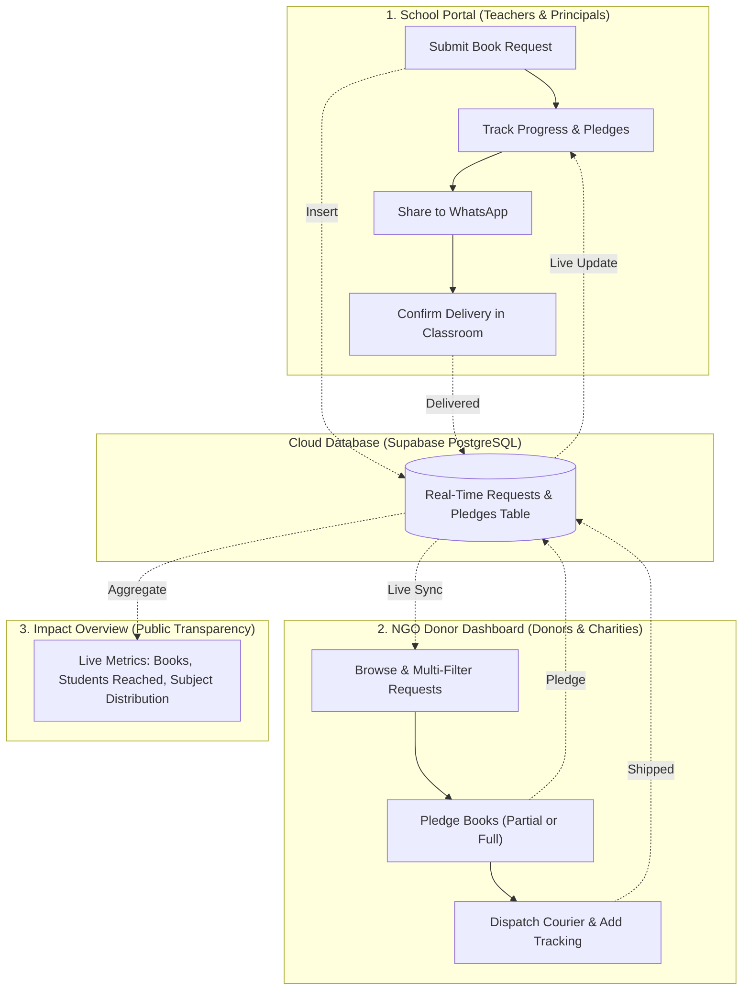

# 📖 BookBridge (Kitaab Dost Network) — Comprehensive User Manual

> **Official User & Operations Guide** for Schools, Education NGOs, and Book Donors.

---

## 🌐 Quick Access Links
- **Live Public URL**: [https://richbrokie.github.io/kitaab-dost/](https://richbrokie.github.io/kitaab-dost/)
- **Localhost Development URL**: `http://localhost:3000/index.html`
- **Cloud Database**: Connected to Supabase PostgreSQL (Real-time synchronization across devices)

---

## 🧭 System Overview & Architecture

BookBridge operates as a **tri-portal platform** accessible from a single interactive interface:

You can toggle between roles anytime using the top navigation bar:
- 🏫 **1. School Portal**: For teachers, administrators, and headmasters.
- 🤝 **2. NGO Donor Dashboard**: For partner NGOs, trusts, and individual book donors.
- 📊 **3. Impact Overview**: For public metrics and donor transparency.

---

## 🏫 Section 1: School Portal Guide

This portal is designed for schools facing shortages of textbooks, curriculum workbooks, and library storybooks.

### 1. Submitting a New Book Request
1. Click the **"1. School Portal"** tab on the top bar.
2. Click the black **"+ Submit New Book Request"** button on the hero banner.
3. Fill in the required fields:
   - **School Name**: Official school title (e.g., *Roshni Primary Government School*).
   - **City / District Location**: City and province (e.g., *Multan, South Punjab*).
   - **Grade Level**: Primary (1–5), Middle (6–8), Matric (9–10), or Intermediate (11–12).
   - **Subject Category**: Science, Mathematics, English, Urdu, CS, or Social Studies.
   - **Book Title / Curriculum**: Exact title, publisher, and edition (e.g., *PTB Class 8 General Science & Lab Manual*).
   - **Why are these books needed?**: Explain the classroom situation (e.g., *4 students currently share 1 textbook; upcoming exams in November*).
   - **Quantity Needed**: Number of copies required (min: 5, max: 500).
   - **Urgency Level**:
     - 🔴 **Critical**: Needed immediately for exams or lost to natural disasters/floods.
     - 🟡 **High**: Needed within the current month/term.
     - 🔵 **Medium**: General classroom reading corner or library enhancement.
   - **Focal Person & Phone**: Headmaster/Principal name and active WhatsApp/mobile contact.
4. Click **"Publish Book Request"**.
   - *Result*: The request is saved directly to the **Supabase cloud database** and immediately appears in the NGO feed across all devices.

---

### 2. Tracking Request Status & Delivery
Every book request moves through a 5-stage lifecycle:

| Status Badge | What it Means | Next Step |
| :--- | :--- | :--- |
| ⏳ **Pending** | Request is live; waiting for first donor pledge. | Share link on WhatsApp to boost visibility. |
| 🕒 **Partially Funded** | An NGO has pledged some books, but more are needed. | Wait for remaining pledges. |
| ✅ **Fulfilled** | 100% of the requested books have been pledged. | NGO is preparing packages for courier dispatch. |
| 🚚 **Shipped** | Books are in transit via courier (TCS, Leopards, etc.). | School tracks courier and awaits delivery. |
| 📦 **Delivered** | Books have arrived and are confirmed in classroom circulation. | Request completed; acknowledgment logged. |

---

### 3. Confirming Arrival of Books (Closing the Loop)
When an NGO marks your books as **"Shipped"**:
1. Go to your request card in the **School Portal**.
2. A purple button labeled **"Confirm Books Received"** will appear on the right side.
3. Click the button to open the **School Delivery Receipt** dialog.
4. (Optional) Enter a thank-you note or classroom update (e.g., *"Books arrived in great condition; handed to Grade 6 students today. Thank you!"*).
5. Click **"Confirm Books Received in Classroom"**.
   - *Result*: The card changes to **"Delivered in Classroom"** and logs your thank-you receipt to the public activity feed.

---

### 4. Sharing Requests on WhatsApp
Every card has a dedicated green **"Share on WhatsApp"** button:
- Clicking it opens WhatsApp (web or mobile app) with a pre-formatted message containing:
  - School name and location
  - Missing book title and quantity needed
  - Direct live URL to view and pledge
- Ideal for sharing in alumni groups, community welfare forums, and education activist chats.

---

## 🤝 Section 2: NGO Donor Dashboard Guide

This portal is designed for verified charities, education foundations, alumni associations, and corporate CSR wings looking to fund or ship books.

### 1. Finding & Filtering Needs
Use the top multi-filter control bar to find exact matches:
- **Search Bar**: Type any school name, district, city, or book title.
- **Subject Filter**: Filter specifically for STEM, Languages, Mathematics, or Computer Science.
- **Grade Filter**: Target specific cohorts (e.g., Primary schools vs. Matric exam classes).
- **Urgency Filter**: Prioritize **Critical** requests facing upcoming board exams.
- **Status Tabs**:
  - `Needs Books`: Only displays requests that still have remaining unfunded copies.
  - `Completed`: Displays fulfilled, shipped, or delivered requests.
  - `All`: Full archive view.

---

### 2. Pledging Books (Full or Partial)
1. Find a request you want to support.
2. Click the green **"Donate / Pledge Books"** button on the bottom right of the card.
3. In the pledge modal:
   - **NGO / Donor Organization Name**: Enter your foundation or donor name (e.g., *Read Pakistan Foundation*).
   - **Number of Books to Pledge**: Enter the exact quantity you can supply.
     > [!TIP]
     > Click the shortcut **"Fulfill Entire Remaining"** to automatically set the quantity to 100% of what the school needs.
   - **Delivery / Dispatch Note**: Add details for the principal (e.g., *"Sending 40 copies from our Lahore warehouse via TCS courier on Tuesday"*).
   - **Check "Mark Shipped Immediately"**: Check this box if the package is already packed and on its way.
4. Click **"Confirm Book Pledge"**.
   - *Result*: The remaining count decreases in real time, the progress bar updates, and the school is notified.

---

### 3. Marking Dispatched Packages
Once an NGO has pledged 100% of the books:
1. The request status updates to **Fulfilled**.
2. A blue button labeled **"Mark Dispatched"** appears on the card.
3. Click **"Mark Dispatched"** once the courier receipt/tracking number has been generated.
4. The school principal will immediately see the **"Shipped via Courier"** status on their portal.

---

## 📊 Section 3: Impact Overview Guide

Click the blue **"3. Impact Overview"** tab at the top to access the public transparency dashboard:

1. **Top Metric Cards**:
   - **Total Books Pledged**: Real-time counter of all physical books pledged across Pakistan.
   - **Estimated Students Reached**: Computed estimate (each shared textbook reaches an average of 2 students).
   - **Fulfilled Requests**: Number of classroom requests that reached 100% funding.
   - **Registered Schools**: Total under-resourced institutions participating.
2. **Subject Breakdown**:
   - Live visual fulfillment bars for Science, Mathematics, English Literature, Urdu & Regional, Computer Science, and Social Studies.
   - Helps donor organizations see which academic subjects are under-funded and need intervention.

---

## ⚡ Section 4: Operational Best Practices for Pakistan

To ensure smooth real-world textbook logistics:

### A. Curriculum Editions & Specifications
When submitting or pledging books, verify the provincial board:
- **Punjab**: Punjab Curriculum & Textbook Board (PTB / PCTB).
- **Sindh**: Sindh Textbook Board (STB Jamshoro).
- **Khyber Pakhtunkhwa**: KP Textbook Board Peshawar.
- **Balochistan**: Balochistan Textbook Board Quetta.
- **Private/Cambridge**: Oxford University Press (OUP), Gaba, or Paramount.

### B. Courier Delivery Options
When pledging delivery, recommend using tracked couriers:
- **TCS / Leopards Courier**: Best for urban and semi-urban school addresses.
- **Pakistan Post (UMS / VPP)**: Recommended for remote rural schools in Swat, Thar, or interior Balochistan.
- **Daewoo FastEx / Cargo**: Economical for large wholesale box shipments (50+ books) between major transport terminals.

---

## 🛠️ Section 5: Troubleshooting & Reset

| Issue | Cause | Solution |
| :--- | :--- | :--- |
| **"Supabase Cloud Synced" indicator is yellow** | Offline or internet hiccup | Site automatically uses cached data; re-syncs as soon as connection restores. |
| **I want to reset back to clean demo data** | Testing sample flows | Click the gray **"Reset Demo"** button on the top right bar. |
| **Pledge quantity cannot exceed need** | Built-in guard | The modal prevents donating more copies than the school requested to avoid book waste. |
